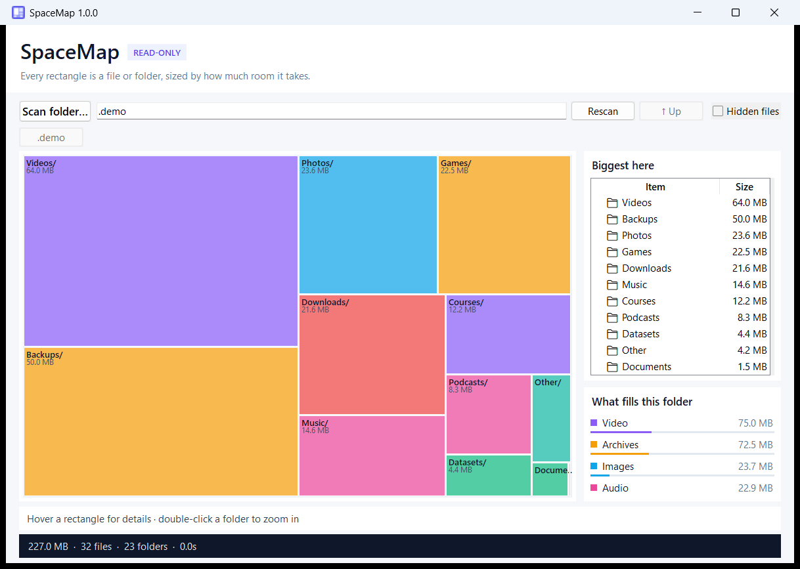

# SpaceMap

**See where your disk space went — a treemap of every folder, drawn from your real files.**

Day 3 of **30 Windows tools in 30 days** · 100% open source (MIT)

[](https://github.com/hassanelsayed91/spacemap/actions/workflows/ci.yml)




---

## The problem

You have 40 GB free and no idea why. Windows Explorer shows folder sizes only if you
hover, one folder at a time, and a list of names tells you nothing about proportion:
a 200 MB folder and a 20 GB folder look exactly the same.

SpaceMap scans a folder, then draws it. **Every rectangle is a file or folder, and its
area is its real size.** The biggest space hogs are literally the biggest shapes, so you
find the 20 GB culprit in one glance instead of clicking through a tree.

And the important part: **SpaceMap is read-only.** It opens files for reading, computes
sizes, and writes nothing — no deletion, no moving, no "cleaning", no journal, no config
in your home folder. It is a map, not a cleaner.

## Features

- **Squarified treemap** (Bruls, Huizing & van Wijk): tiles stay close to square, so sizes stay comparable instead of turning into slivers.
- **Drill-down navigation**: double-click a folder to zoom in, breadcrumb + `Esc` to go back up.
- **Coloured by content**: a folder takes the colour of the file type that fills most of it (video, images, archives, code…), and the sidebar shows the exact breakdown.
- **Hover for the truth**: full path, exact bytes and share of the parent, without opening Explorer.
- **Hard links counted once** so the total matches what the disk really uses — not the sum of every path.
- **Symlinks are never followed**, so a junction pointing at `C:\` cannot make the scan explode.
- **Unreadable folders don't stop the scan** — they are counted, reported, and skipped.
- **CLI + GUI + reports**: an indented tree, a category legend, JSON for tooling, CSV for spreadsheets.
- **No dependencies, no install, no telemetry.** Standard library + Tkinter.

## Quick start

```powershell
git clone https://github.com/hassanelsayed91/spacemap.git
cd spacemap

python -m spacemap gui                 # desktop treemap
python -m spacemap scan "D:\"          # text report, read-only
```

Requires Python 3.10+ on Windows. Nothing to `pip install`.

### No Python? Use the .exe

```powershell
.\build.ps1     # -> dist\SpaceMap.exe (GUI) + dist\SpaceMap-CLI.exe
.\install.ps1   # copies to %LOCALAPPDATA%\Programs\SpaceMap + shortcuts
```

### Command line

```powershell
# Map your whole D: drive, show the 5 biggest files at the end
python -m spacemap scan "D:\" --top 5

# Just the big stuff, save a report for later
python -m spacemap scan "C:\Users\Hassan" --min-size 100MB --json map.json --csv map.csv

# Deeper tree, more children per folder
python -m spacemap scan "D:\Projects" --depth 5 --limit 20
```

Example output:

```text
SpaceMap 1.0.0 - see where the disk space went
  scanning: .demo

  227.0 MB in 32 files and 23 folders (0.0s)

  Largest items
   227.0 MB  100.0%  .demo
  ├──   64.0 MB   28.2%  Videos\
  │   ├──   34.0 MB   15.0%  holiday-2024.mp4
  │   ├──   18.0 MB    7.9%  birthday.mp4
  │   └──   12.0 MB    5.3%  clip-raw.mov
  ├──   50.0 MB   22.0%  Backups\
  │   ├──   26.0 MB   11.5%  old-laptop.zip
  │   └──   15.0 MB    6.6%  2019-photos.zip
  ...
  By type
  Video         75.0 MB   33.0%  ███████████
  Archives      72.5 MB   31.9%  ██████████
  Images        23.7 MB   10.4%  ███

  Nothing was modified - SpaceMap never writes to your files.
```

## How the map works

1. **Walk** the folder with `os.scandir`, skipping symlinks, hidden/system items (unless asked) and excluded folders.
2. **Sum sizes bottom-up**, remembering how many files live under each folder.
3. **Sort children biggest first**, then lay them out with a squarified treemap: the algorithm adds items to a row while the row's worst width/height ratio improves, then starts a new row.
4. **Fold the noise**: anything under 0.35% of the level (or beyond 320 tiles) becomes one "N smaller items" box, so the map stays readable.
5. **Paint**: folders get the lightened colour of their dominant file type, files get their own type's colour.

The layout functions are pure maths and unit-tested: rectangles never leave the box,
never overlap, and their areas are proportional to the sizes.

## Safety guarantees

| Guarantee | How |
| --- | --- |
| Files are never modified | the only file calls are `scandir`, `stat` and `open(..., "rb")` for nothing at all — sizes come from `stat` |
| Nothing is deleted or moved | there is no delete/move code path in the project |
| No config or journal written | the tool never touches `%LOCALAPPDATA%`; reports are only written when you pass `--json`/`--csv` |
| Symlinks are not followed | a junction to `C:\` is one skipped entry, not a full disk scan |
| Hard links count once | the same physical file is not counted twice, so totals match real usage |
| One locked folder is not fatal | permission errors are counted per item and the scan continues |

## Categories

| Category | Examples |
| --- | --- |
| Images | jpg, png, gif, webp, heic, psd, raw |
| Video | mp4, mkv, avi, mov, webm |
| Audio | mp3, wav, flac, m4a, opus |
| Archives | zip, rar, 7z, iso, tar, gz |
| Installers | exe, msi, msix, appx, apk |
| Documents | pdf, docx, xlsx, pptx, txt, md, epub |
| Code | py, js, ts, html, css, json, sql, ps1 |
| System | dll, sys, dat, log, tmp, bin, db |
| Other | everything else |

## Keyboard and mouse

| Action | Result |
| --- | --- |
| Hover a rectangle | path, size and share of the folder in the info bar |
| Click | select and highlight the item |
| Double-click a folder | zoom into it |
| Double-click a file | reveal it in Explorer |
| Right-click | open folder, copy path, copy name + size |
| Breadcrumb button | jump back to any level |
| `Esc` / `↑ Up` | go one level up |

## Development

```powershell
python -m pytest -q          # 66 tests, standard library only
python tools/make_icon.py    # rebuild the icon (needs Pillow)
python tools/screenshot.py   # rebuild the README screenshot (needs Pillow)
```

Project layout:

```text
spacemap/
  core.py      scanning, tree model, squarified layout, categories, exports
  cli.py       scan / gui
  gui.py       Tkinter treemap with drill-down
tests/         66 unit tests
tools/         icon + screenshot helpers (dev only)
build.ps1      PyInstaller builds
install.ps1    per-user install with Desktop + Start Menu shortcuts
```

## Contributing

Issues and pull requests are welcome. Keep the project dependency-free (standard library
only) and add a test for any layout or scanning change. A treemap bug is a visual lie, so
the maths is tested harder than the UI.

## License

MIT © 2026 Hassan Elsayed

---

## بالعربي

**SpaceMap** أداة ويندوز مفتوحة المصدر بترسم لك خريطة تخزين (treemap) لمجلد أو للهارد
كله: كل مستطيل = ملف أو فولدر، ومساحته على الشاشة = المساحة الحقيقية اللي بياخدها.

**المشكلة:** مستكشف ويندوز بيعرض أحجام الفولدرات واحد واحد، والقائمة العادية مش بتوريك
النسب: فولدر 200 ميجا وفولدر 20 جيجا شكلهم واحد في القائمة. فبتفضل تدور وتفتح فولدر
ورا فولدر عشان تعرف مين بياكل المساحة.

**الحل:** الأداة بتقرأ أحجام الملفات وترسمها. أكبر مستطيل هو أكبر مستهلك للمساحة،
فتلاقي المشكلة في نظرة واحدة بدل ما تفتح عشرين فولدر.

**الأهم: الأداة قراءة فقط (read-only).** مفيش حذف، مفيش نقل، مفيش "تنظيف"، ومفيش أي
ملف إعدادات أو سجل بتكتبه في جهازك. دي خريطة، مش منظّف.

```powershell
python -m spacemap gui                 # افتح الخريطة التفاعلية
python -m spacemap scan "D:\" --top 5  # تقرير نصي بأكبر الملفات
python -m spacemap scan "D:\" --min-size 100MB --json map.json
```

**طريقة الاستخدام:** مرّر الماوس على أي مستطيل تشوف المسار الكامل والحجم والنسبة،
دوس دبل كليك على فولدر تدخل جواه، واستخدم شريط المسار أو `Esc` للرجوع. كليك يمين
بيفتح المكان في المستكشف أو بينسخ المسار.

**تفاصيل مهمة:** الألوان بتوريك نوع المحتوى الغالب في كل فولدر (فيديو، صور، أرشيفات،
كود…) وشريط جانبي بيوريك النسب بالظبط. الروابط الرمزية (symlinks) مش بتتتبع، والـ hard
links بتتحسب مرة واحدة عشان الإجمالي يطابق المساحة الحقيقية على القرص.

اليوم الثالث من تحدي **30 أداة ويندوز في 30 يوم** — كل أداة مستودع مستقل بترخيص MIT.

الترخيص: MIT © 2026 حسن السيد
